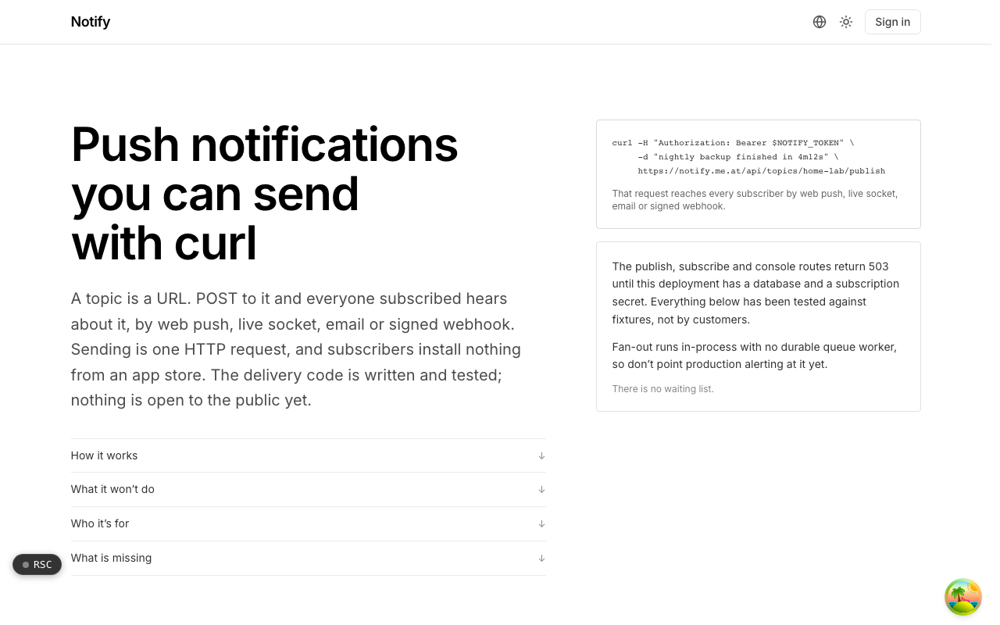
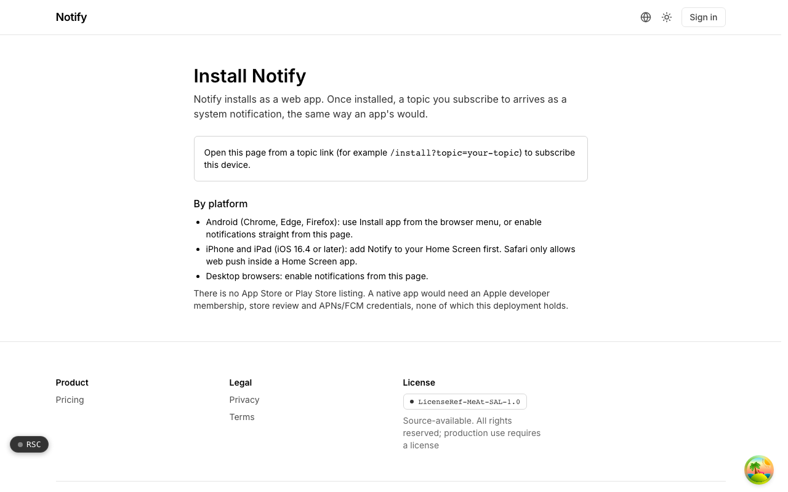

  <picture>
    <source media="(prefers-color-scheme: dark)" srcset=".github/assets/hero-dark.png">
    
  </picture>

# notify.me.at

Push notifications you can send with curl.

notify.me.at is topic-based push over plain HTTP. A topic is a URL: POST to it and every subscriber hears about it by web push, a live socket, email, or a signed webhook. It is meant for the small alerts you want to see within a minute (a backup finished, a build broke, a certificate is about to expire) and is honest about what each channel actually guarantees. The delivery code is written and tested; the service is not open to the public yet.

## Features

- **Four channels, one contract**: web push, a live socket, email, and a signed outbound webhook per subscription, each returning typed results that decide retry or removal.
- **Web push written from the RFCs**: VAPID and payload encryption (RFC 8030, 8291, 8292) on `node:crypto` alone, with no web-push package or vendor SDK.
- **Closed topics by default**: publishing needs a write token; anonymous publishing is a per-topic opt-in with per-topic and per-source limits, so a topic is never an open relay.
- **Subscriber-owned limits and quiet hours**: a per-subscriber hourly cap enforced at delivery, and quiet hours that hold a notification whenever anything about them is unclear.
- **At most once per subscriber**: deliveries are claimed through a database constraint on the notification identity, so a retried job does not send twice; dead endpoints (410 Gone) are removed, never retried.
- **Careful with data**: push endpoints encrypted at rest with AES-256-GCM, notification bodies never logged, SSRF checks on webhook targets, and per-topic retention windows.
- **Publish audit trail**: accepted, duplicate, rate-limited and denied publishes are all recorded, with source addresses stored only as a salted hash.
- **Installable web app**: installs as a PWA and subscribes a device to a topic, including home-screen web apps on iOS 16.4 and later.

## Screenshots

<table>
  <tr>
    <td width="50%"><picture><source media="(prefers-color-scheme: dark)" srcset=".github/assets/install-dark.png"></picture> Install: add Notify as a web app and subscribe this device to a topic.</td>
  </tr>
</table>

## Built with

- Next.js 16 (App Router), React 19, TypeScript
- Tailwind CSS 4
- Drizzle ORM + Postgres
- Better Auth
- oRPC
- Web Push (VAPID) on `node:crypto`, a service worker, and Svix-compatible webhook signatures

## Part of the me.at family

notify.me.at is one of the [`*.me.at`](https://me.at) apps by Trevor McDougald. They share one design system, account, and app shell. Development happens in a private monorepo; this repository is the project's public-facing home.

## License

See [LICENSE](LICENSE).
