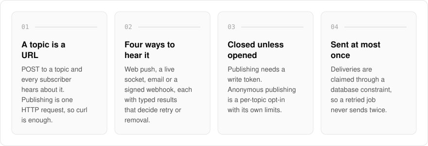
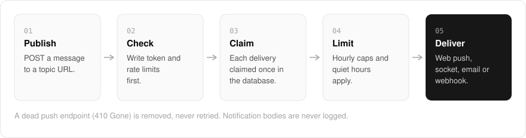

  <picture>
    <source media="(prefers-color-scheme: dark)" srcset=".github/assets/hero-dark.png">
    
  </picture>

<h1 align="center">notify.me.at</h1>

<strong>Push notifications you can send with curl.</strong>

  
  
  
  

  <a href="#features">Features</a> ·
  <a href="#how-it-works">How it works</a> ·
  <a href="#screenshots">Screenshots</a> ·
  <a href="#built-with">Built with</a>

Getting a small alert onto your phone usually means an app, an SDK or an account for every script that wants to say something. I built notify.me.at as topic-based push over plain HTTP: a topic is a URL, you POST to it, and every subscriber hears about it by web push, a live socket, email or a signed webhook. It is meant for the alerts you want to see within a minute (a backup finished, a build broke, a certificate is about to expire), and it is honest about what each channel actually guarantees.

> **Status:** the delivery code is written and tested. The service is not open to the public yet.

  <picture>
    <source media="(prefers-color-scheme: dark)" srcset=".github/assets/overview-dark.svg">
    
  </picture>

## Why notify.me.at

| The usual push service | notify.me.at |
| --- | --- |
| An SDK in every script | One HTTP request to a topic URL |
| Open topics anyone can post to | A write token by default, anonymous publishing opt-in per topic |
| A retry can send the same alert twice | At most once per subscriber, claimed through a database constraint |
| Alerts at any hour | An hourly cap and quiet hours, owned by the subscriber |

## Features

- **Four channels, one contract**: web push, a live socket, email, and a signed outbound webhook per subscription, each returning typed results that decide retry or removal.
- **Web push written from the RFCs**: VAPID and payload encryption (RFC 8030, 8291, 8292) on `node:crypto` alone, with no web-push package or vendor SDK.
- **Closed topics by default**: publishing needs a write token, and anonymous publishing is a per-topic opt-in with per-topic and per-source limits, so a topic is never an open relay.
- **Subscriber-owned limits and quiet hours**: a per-subscriber hourly cap enforced at delivery, and quiet hours that hold a notification whenever anything about them is unclear.
- **At most once per subscriber**: deliveries are claimed through a database constraint on the notification identity, so a retried job does not send twice. Dead endpoints (410 Gone) are removed, never retried.
- **Careful with data**: push endpoints encrypted at rest with AES-256-GCM, notification bodies never logged, SSRF checks on webhook targets, and per-topic retention windows.
- **Publish audit trail**: accepted, duplicate, rate-limited and denied publishes are all recorded, with source addresses stored only as a salted hash.
- **Installable web app**: installs as a PWA and subscribes a device to a topic, including home-screen web apps on iOS 16.4 and later.

## How it works

  <picture>
    <source media="(prefers-color-scheme: dark)" srcset=".github/assets/flow-dark.svg">
    
  </picture>

A publish is a POST to the topic's URL. It is checked against the topic's write token and rate limits, and the outcome is recorded in the audit trail either way. Each delivery is then claimed once per subscriber in the database, subject to that subscriber's hourly cap and quiet hours, and sent over web push, the live socket, email or a signed webhook.

## Screenshots

<table>
  <tr>
    <td width="50%"><picture><source media="(prefers-color-scheme: dark)" srcset=".github/assets/hero-dark.png"></picture> The landing page: publish to a topic, receive on every channel.</td>
    <td width="50%"><picture><source media="(prefers-color-scheme: dark)" srcset=".github/assets/install-dark.png"></picture> Install: add Notify as a web app and subscribe this device to a topic.</td>
  </tr>
</table>

## Built with

  
  
  
  
  
  

- Next.js 16 (App Router), React 19, TypeScript
- Tailwind CSS 4
- Drizzle ORM + Postgres
- Better Auth
- oRPC
- Web Push (VAPID) on `node:crypto`, a service worker, and Svix-compatible webhook signatures

## Part of the me.at family

notify.me.at is one of my [`*.me.at`](https://me.at) apps. They share one design system, account, and app shell. Development happens in a private monorepo; this repository is the project's public-facing home.

## License

Source-available. See [LICENSE](LICENSE).
